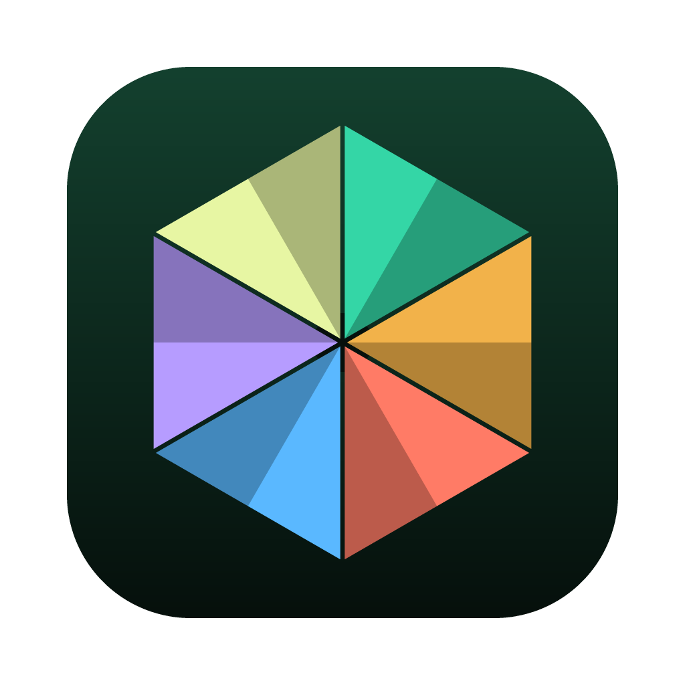
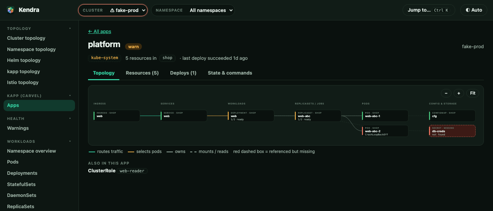
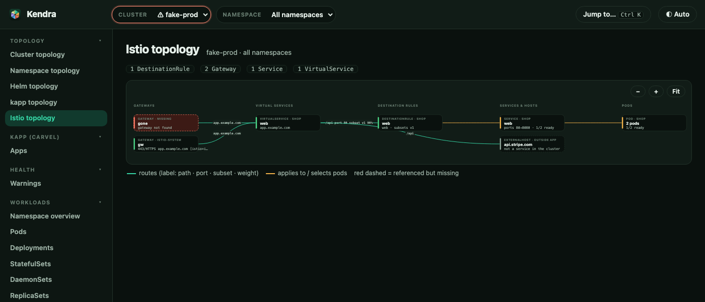
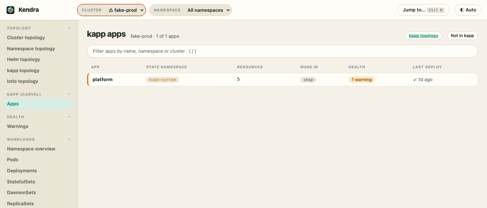
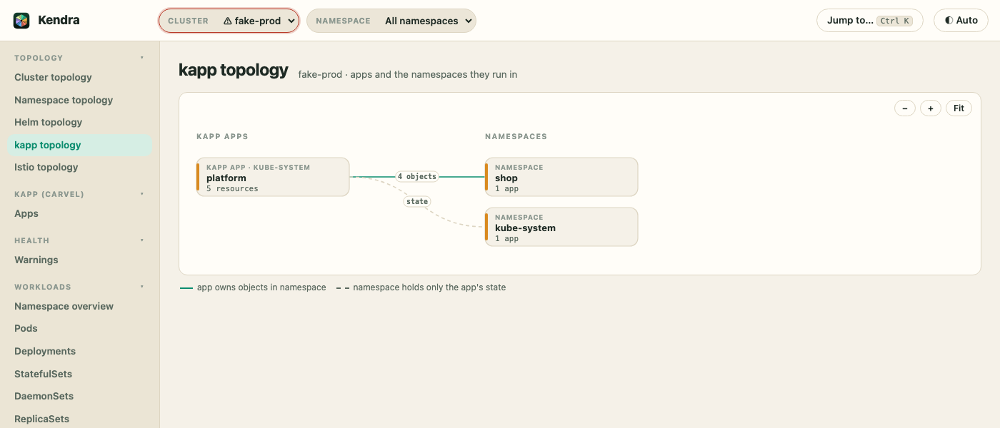

<p align="center"></p>

# Kendra

**One window onto every Kubernetes cluster in your kubeconfig, with first-class [Carvel kapp](https://carvel.dev/kapp/) and Istio topology.**

## Table of Contents

1. [Overview](#overview)
2. [Prerequisites](#prerequisites)
3. [Installation](#installation)
4. [Running the Project](#running-the-project)
5. [Testing](#testing)
6. [Contributing](#contributing)
7. [Maintainers](#maintainers)
8. [Additional Resources](#additional-resources)
9. [Troubleshooting](#troubleshooting)

---

## Overview

Kendra is a single program, `knd`. It starts a small web server on `127.0.0.1` and opens the UI in an app window.
It reads your kubeconfig the way `kubectl` does: if `kubectl get pods` works, Kendra works (EKS, AKS, GKE, kind, ...).
Nothing is installed in your clusters and nothing leaves your machine except calls to your own clusters.

- **Purpose:** one place to see, compare and check every cluster you work with, and to plan upgrades, without changing anything.
- **Scope:** read-only. There is no edit, delete, scale, restart or cordon. Deploys stay with `kapp`, Helm and your pipelines.
- **Audience:** platform and SRE engineers who run many Kubernetes clusters (EKS, AKS, GKE) and use Carvel kapp and Istio.



### Key features

**Topology** (first group in the left rail)

| Page | Shows |
|---|---|
| **Cluster topology** | Node pools → nodes → the namespaces whose pods run on them. Nodes are coloured by readiness, namespaces by their worst pod. |
| **Zones & pod spread** | Nodes grouped by availability zone (`topology.kubernetes.io/zone`) with node counts and pod counts per zone, a tile per node (pods, CPU requested, pool, not-ready and cordoned marks), and for every workload where its pods run: per zone and per node. Flags workloads with all pods on one node, all in one zone, or lopsided between zones. |
| **Namespace topology** | One namespace: Ingress → Service → Deployment/StatefulSet/DaemonSet/CronJob → ReplicaSet/Job → Pods, plus the ConfigMaps, Secrets and claims they use. Missing references are red. Works whatever tool created the objects. |
| **Helm topology** | Helm releases → the namespaces they run in. Click a release for its objects, revisions and a topology. |
| **Kapp topology** | kapp apps → the namespaces they run in, including apps whose state lives in `kube-system`. Click an app for its topology. |
| **Istio topology** | Gateway → VirtualService → DestinationRule → Service (ports) → pods. |

Helm support reads only the labels of Helm's release Secrets (never their data) and finds objects by
`app.kubernetes.io/managed-by=Helm` plus the `meta.helm.sh/release-name` annotation. Objects from charts that do not set
that label are not found.

**Fleet** (first group in the left rail; built for many clusters)

| Page | Shows |
|---|---|
| **Fleet dashboard** | One card per cluster: version, nodes ready, pods, failing and pending pods, warnings in the last hour, namespaces, pressure and cordoned nodes. Cards fill in as each cluster answers (6 at a time); unreachable clusters get their own red card. Click a status chip to filter, click a card to open the cluster. |
| **Fleet search** | One box to find text across every cluster in scope (or one namespace): in image names, labels, object names (and Ingress hosts), env var names and annotations of Deployments, StatefulSets, DaemonSets, CronJobs, Services, Ingresses and Namespaces. You pick which of the five to search; part of a word is enough. Env var values and Secret or ConfigMap contents are never read, and `last-applied-configuration` is skipped. Each cluster shows at most 500 matches. |
| **Versions** | Control-plane and kubelet versions of every cluster, how many minors each is behind the newest in the group, and node skew. |
| **Deprecated APIs** | Deprecated API versions each cluster still serves, with the objects whose last write used them (from `managedFields`: kubectl, Helm, kapp, controllers), whether a client requested them (API server metrics, when readable), and the replacement. "Next upgrade" marks versions removed in the next minor. |

**Insights** (second group in the left rail)

| Page | Shows |
|---|---|
| **Certificates** | cert-manager Certificates across the picked clusters, soonest expiry first: expired, expiring within 30 days, not ready. Only Certificate objects are read, never the Secrets. |
| **Image inventory** | Every image and tag running, per repository, with the clusters and namespaces. Filters for "more than one tag in use" and "untagged or :latest". |
| **Usage vs requests** | CPU and memory used against requested and limited, per workload or namespace. Flags over-sized workloads, workloads above their request and pods with no requests. Needs metrics-server for the usage side. |
| **Security** | Workloads whose pods use host network, host PID/IPC, hostPath volumes, privileged containers, root user or extra capabilities, plus the Pod Security labels (enforce, audit, warn) of every namespace and which have none. Reads pod specs and namespace labels only. |
| **Cloud identities** | Service accounts tied to an AWS IAM role (IRSA), an Azure workload identity or a Google service account, with the workloads that run as them and the ones no pod uses. |
| **Add-ons** | cert-manager, External Secrets, ExternalDNS, Velero, Prometheus Operator, ingress-nginx, AWS Load Balancer Controller, metrics-server, KEDA, Karpenter, Istio, Kyverno, Gatekeeper and Datadog Operator per cluster: version, ready pods, and a note (failed Velero backup, ExternalSecrets not syncing). |
| **Add-on compatibility** | Each add-on found by the Add-ons page (cert-manager, metrics-server, KEDA, Datadog Operator and the rest) judged against the cluster's Kubernetes version and a target minor you pick (default: next). ✅ official source covers it, ❌ outside the supported window, ⚠️ no official statement. Ranges come from `internal/kube/compat/compat.json`, which carries a source link and the date it was checked per add-on (cert-manager, metrics-server, KEDA, Datadog Operator, Karpenter, ingress-nginx, External Secrets and Istio so far); add-ons not in the file show ⚠️. Releases past their end-of-support date and retired projects (ingress-nginx) show ❌. For EKS and AKS clusters the page also shows where the cluster's own version and the target stand in the provider's support calendar (standard, extended or ended). Add a row only from an official source. |
| **Jobs and CronJobs health** | Every CronJob with its next run (worked out from the schedule, in its time zone or UTC), last scheduled, last success and last Job, with the failed pod and why it failed. Flags failed runs and how many in a row, suspended CronJobs, CronJobs that stopped being scheduled and Jobs that run too long, plus Jobs that no CronJob owns and that failed or run for over a day. Left rail: Workloads. |
| **Change timeline** | What changed in the last hour to 7 days: rollouts, scaling and warning events, container restarts, node condition changes. |
| **Gateway API** | Gateways with listeners, addresses and programmed status, and HTTPRoute, GRPCRoute and TLSRoute objects with the services they send traffic to (missing backends in red) and their acceptance status. |
| **Compare clusters** | Two clusters side by side, optionally one namespace: workloads (replicas, images), services, ingresses and ConfigMap key names. Values of ConfigMaps and Secrets are never read. |

Every Fleet and Insights table has **Copy Markdown**, **Save CSV** and **Save .md** (a Save panel in the Mac app, a download in a browser).
**Trends and the time machine.** For the clusters you look at (up to 10 at a time) Kendra takes a small sample once a minute and keeps six hours of them in memory only (nothing is written to disk, nothing to a cluster). Fleet cards and the Namespace overview show failing-pod sparklines; **Time machine** (under Health) has a slider and Play button to see what was failing earlier and what has been fixed or broken since.
**Related** and **Impact** tabs on pods, workloads, services, ingresses, ConfigMaps, Secrets, claims, service accounts and nodes show what an object uses, what uses it, and what stops if it goes away (pods, services left with no ready pod, ingresses).
**Pins and saved views.** Star clusters in the picker or on the start screen to pin them first. **Save view** in the top bar keeps a page with its cluster scope, namespace and filter in the left rail (stored in this app only).
**Why?** now also works on nodes, volume claims, services and Deployments, StatefulSets and DaemonSets (stuck rollouts).
**Incident** tab on pods, Deployments, StatefulSets, DaemonSets, services, volume claims and nodes: one Markdown report for a ticket or chat with what is wrong (the Why? findings), the object's events, the pods behind it, what it uses and what uses it, what stops if it goes away, what changed around it in the last 6 hours and the `kubectl` commands to look further. **Copy Markdown** or **Save .md**. It never includes logs, YAML or Secret values.

**Cluster picker.** The Cluster box in the top bar is searchable. Type to filter, or pick a group: `PROD`, `TEST`, `DEV`, `ACP`
(from name parts split by `-`, `_`, `.`), `AKS`, `EKS`, `GKE` or `Local`. Typing a word also offers "all N clusters matching …".
Picking a group lists its clusters first: choose **All N in this group**, or one cluster. A group scopes every "all clusters" page and the Fleet and Insights pages.

**Left rail**

| Section | Pages |
|---|---|
| **Fleet** | **Fleet dashboard**, **Versions**, **Deprecated APIs** (every cluster at once) |
| Topology | Cluster, Zones & pod spread, Namespace, Helm, Kapp, Istio |
| Health | Warnings, **Time machine** |
| Workloads | **Namespace overview** (every namespace at a glance), Pods, Deployments, StatefulSets, DaemonSets, ReplicaSets, Jobs, CronJobs |
| Cluster | Nodes, Namespaces, Events |
| Config | ConfigMaps, Secrets, Resource quotas, Limit ranges, Pod disruption budgets, Priority classes, Runtime classes, Leases |
| Network | Services, Endpoints, Endpoint slices, Ingresses, Ingress classes, Istio gateways, Istio virtual services, Network policies, **Port forwarding** |
| Storage | Persistent volume claims, Persistent volumes, Storage classes |
| **Security** | **Security overview**, **Cloud identities**, **Certificates**, then Service accounts, Cluster roles, Roles, Cluster role bindings, Role bindings |
| **Kyverno** | Cluster policies, Policies, Validating and Mutating policies, Policy exceptions, Policy reports and Cluster policy reports (red when a report has failures), Cleanup policies. Shown as "not installed in this cluster" where Kyverno is absent. |
| **Platform** | **Add-ons**, **Gateway API**, HPAs, ScaledObjects, TriggerAuthentications (KEDA), NodePools, EC2NodeClasses, NodeClaims (Karpenter), Helm releases and charts, plus the Gateway API and Istio resources the cluster has (networking, security, telemetry) |
| Custom Resources | Definitions, then **every CRD of the cluster grouped by API group**; click one to list its objects |

Sections fold; the one holding the current page opens by itself. Pages for add-ons (KEDA, Karpenter, Istio) say
"not installed in this cluster" when the cluster does not serve that API, instead of failing.

**Port forwarding.** Start one from a pod or service (**Forward port…**) or from the Port forwarding page. It listens on
`127.0.0.1` only, lives until Kendra exits, resolves a Service to one of its ready pods, and is written to the audit log.
It changes nothing in the cluster.

**Helm charts.** *In use* comes from the `helm.sh/chart` label of each release's objects. *Local repositories* reads the
repositories and cached indexes of `helm repo add` / `helm repo update` on your machine (nothing is downloaded).

**kapp (Carvel) first**

- **Apps.** Finds every kapp app in every namespace (state ConfigMaps labelled `kapp.k14s.io/is-app`, usually in
  `kube-system`) and lists them with health, the namespaces they run in, and the last deploy.
- **App topology.** For one app: Ingress → Service → Deployment/StatefulSet/DaemonSet/CronJob → ReplicaSet/Job → Pods,
  plus the ConfigMaps, Secrets and claims they mount. A reference to something that does not exist is drawn as a red
  dashed "missing" box. Objects the app owns that are not drawn (RBAC, CRDs, Namespaces) are listed below.
  Resources are found by the `kapp.k14s.io/app` label across **all** resource types, CRDs included.
- **Topology map.** Every app on the left, every namespace it touches on the right. Shows apps that keep their state in
  `kube-system` but run elsewhere.
- **Deploys.** The change history kapp records for each app, and handy `kapp inspect` / `kapp app-change list` commands.
- **Not in kapp.** Deployments, StatefulSets, DaemonSets and CronJobs that no kapp app owns.

**Istio topology**

Gateway → VirtualService → DestinationRule → Service (with ports) → pods, built from `networking.istio.io` resources.
Edge labels show host, path, port, subset and weight. Hosts that resolve to no Service, and Gateways that do not exist,
are flagged. External hosts and ServiceEntries show up as "outside the mesh".

**Everyday cluster work**

- Any cluster, or **all clusters at once**. An unreachable cluster gets its own error line and does not block the rest.
- Pods, Deployments, StatefulSets, DaemonSets, Jobs, Services, Ingresses, ConfigMaps, Secrets, Nodes, Events and more,
  with the columns the cluster itself reports. Rows are green, amber or red. Live CPU and memory for pods when
  metrics-server is present.
- **Why?** on a pod reads its status and events and says what is wrong in plain words.
- **Warnings** groups warning events so 40 identical messages become one line, with a hint.
- Logs (live, previous container, search), YAML, events. Secret values are never sent to the browser.
- **Read-only.** Kendra has no edit, delete, scale, restart or cordon: the server has no such endpoint and the code
  never calls a write verb (a test enforces it). The only thing it records, in `~/.kendra/audit.log`, is a port
  forward you start.
- **Light and dark themes.** Follows your system; the button in the top bar switches between Auto, Light and Dark.
- `Ctrl/⌘ K` jumps to any view, resource type, cluster or namespace. `/` focuses the filter.



<p align="center">


</p>

### Security notes

- Listens on `127.0.0.1` only; a different bind address is refused.
- A random token per run, a `SameSite=Strict` cookie, a `Host` check against DNS rebinding, and a custom header required
  on every change, so a web page in another tab cannot call the API.
- Secret values and the `last-applied-configuration` annotation are removed server-side.
- Read-only by construction: no endpoint changes a cluster, and a test fails if any code calls a write verb.

### Limits

- No terminal UI and no shell into pods or nodes.
- Helm is read-only and limited to what the labels reveal (no values, no manifest diff).
- kapp apps are read-only: Kendra shows and explains them, deploys stay with the `kapp` CLI.
- Cluster-wide kapp discovery lists every resource type once per page load. On big clusters the first load can take
  several seconds; the result of API discovery is cached for 5 minutes.
- Tested against a fake API server and in a browser; try it on a non-production cluster first.

## Prerequisites

| Tool | Purpose | Version / notes |
|---|---|---|
| A kubeconfig that works | Kendra reads the same files as `kubectl` | `kubectl get pods` must work on at least one cluster |
| macOS | Run the app or the `.pkg` | 12 or newer, Apple silicon or Intel |
| Go | Build from source | 1.24 or newer (`brew install go`) |
| Xcode command line tools | Build the native macOS window (cgo) | `xcode-select --install` |
| `make` | Build, test and package | any recent version |
| Node.js | JavaScript checks in `make test` | 22 (the CI image uses 22) |
| `aws` CLI v2 | EKS clusters (`aws sso login`, `aws eks get-token`) | only for clusters that use it |
| `az` CLI and `kubelogin` | AKS clusters (`az login`) | only for clusters that use it |
| `gke-gcloud-auth-plugin` | GKE clusters | only for clusters that use it |
| Chrome, Edge, Brave or Chromium | Window on Linux and Windows | optional; the default browser is used otherwise |

Cluster logins work exactly as for `kubectl`: log in first, then start Kendra. If your cluster endpoints are private, connect to the VPN first.

## Installation

### Install the app

**Mac, from the installer.** Open `Kendra-<version>.pkg` and follow the steps. It puts **Kendra** in Applications (Spotlight, Dock, Cmd-Tab, own icon and menu bar) and `knd` on your PATH. The package is not notarized unless the builder had an Apple Developer ID: the first time, right-click the `.pkg` and choose **Open**. Then start **Kendra** from Spotlight, or run `knd` in a terminal.

The `.pkg` is built on a Mac with `make pkg` (universal: Apple silicon and Intel) and handed out with the release. Linux and Windows archives are built by the GitHub Actions release workflow when a version tag is pushed. See [Deployment](#deployment).

**From source (Mac or Linux).** You need Go and, on a Mac, the Xcode command line tools.

```shell
git clone https://github.com/sandeeplamb/kendra.git
cd kendra                    # the repository directory (contains go.mod)
./install.sh                 # Mac: /Applications/Kendra.app + knd on PATH. Linux: knd + app-menu entry
open -a Kendra               # or Spotlight: "Kendra"; from a terminal: knd
./install.sh --uninstall     # removes the app and knd (keeps ~/.kendra)
```

No admin rights are needed: if `/Applications` or `/usr/local/bin` is not writable, the installer uses `~/Applications` and `~/.local/bin`. [INSTALL.md](INSTALL.md) has the details, updating and building the `.pkg`.

On macOS Kendra opens in a native window of its own (WebKit), so it has its own Dock icon, menu bar and Cmd+Q. On Linux and Windows it opens in Chrome, Edge, Brave or Chromium as an app window, or in your default browser.

### Configuration

Kendra needs no config file. These environment variables change its behaviour:

| Variable Name | Description | Default Value | Required |
|---|---|---|---|
| `KUBECONFIG` | Which kubeconfig file(s) to read | `~/.kube/config` | No |
| `KND_PROD` | Regular expression for contexts shown as production (red ring, PROD tag) | `(?i)(^\|[-_/.])(prod\|production\|prd)([-_/.]\|$)` | No |
| `KND_LOCAL` | Regular expression for local contexts | `(?i)^(kind-\|minikube\|docker-desktop\|rancher-desktop\|colima\|orbstack\|k3d-)` | No |
| `KND_AUDIT_LOG` | Where port forwards are recorded | `~/.kendra/audit.log` | No |
| `KND_BROWSER` | `1` on macOS opens a Chrome app window instead of the native window | unset | No |
| `SIGN_APP` | `Developer ID Application: ...` identity, used by `make pkg` to sign the app | unset | Only to sign |
| `SIGN_PKG` | `Developer ID Installer: ...` identity, used by `make pkg` to sign the package | unset | Only to sign |
| `NOTARY_PROFILE` | `xcrun notarytool` keychain profile, used by `make pkg` to notarize | unset | Only to notarize |

Your pins, saved views and theme are kept in the app's own browser storage on your machine. Nothing is written to a cluster.

## Running the Project

```shell
knd                          # start Kendra and open the window
knd --no-open                # only print the address
knd --addr 127.0.0.1:8080    # another port (only 127.0.0.1 is accepted)
KND_BROWSER=1 knd            # on macOS, use a Chrome app window instead of the native window
knd version                  # print the version
```

For development, from the repository directory:

```shell
make build                   # builds ./knd (macOS: with the native window, needs cgo)
make run                     # build and start
make pkg                     # macOS installer: dist/Kendra-<version>.pkg (universal)
```

- **URL:** the terminal prints an address like `http://127.0.0.1:7799/?t=...`. The `t=` token is new on every run: it is exchanged for a cookie, and the API refuses requests without it. If no window opens (`--no-open`, or a build without the native window), paste that address into a browser.
- **API:** the page talks to a local JSON API under `/api`. It is private to the UI and may change; it is not a public contract.
- **Feature flags:** none. `KND_BROWSER` only picks the window type.
- **Logins:** clusters that use an exec plugin (`aws eks get-token`, `kubelogin`, `gke-gcloud-auth-plugin`) need that tool installed and a valid login (`aws sso login`, `az login`, ...), exactly as for `kubectl`. The app reads your login shell's `PATH` when you start it from Spotlight or the Dock.
- **Trends and the time machine:** history is sampled only for the clusters you look at (up to 10), kept in memory for six hours and lost when you quit.

### Filter syntax

Type in the filter box on any resource list. Words are ANDed.

| Type | To see |
|---|---|
| `api` | anything whose name, namespace, cluster or columns contain "api" |
| `!ok` | only warning or failing rows |
| `ns:shop` · `cluster:prod` | namespace / cluster contains it |
| `status:crash\|error` | the Status column contains "crash" or "error" |
| `restarts>3` · `age<1h` | numeric column / created within the last hour |
| `-kube-system` | hide anything containing it |

## Testing

Run these from the repository directory:

```shell
make test                    # gofmt-clean code is checked in CI; locally: go vet, Go tests and JS checks
make test-go                 # go vet ./... and go test ./...
make test-js                 # node --check on every script and the filter tests
gofmt -l cmd internal packaging   # lists files that are not formatted (CI fails if any)
go test -cover ./...         # coverage per package
go test ./internal/kube -run TestSpread   # one test
```

- **Unit and integration tests:** Go tests run against a fake Kubernetes API server (`internal/kube/fake_test.go`), so no cluster is needed. There are no tests against a live cluster: try changes on a non-production cluster.
- **Read-only guard:** a test fails if any code calls a write verb (`Create`, `Update`, `Patch`, `Delete`, `Apply`, `Evict`, `Bind`) or if a change endpoint exists.
- **Linting:** `go vet` and `gofmt`. There is no separate linter.
- **Pipeline:** every pull request runs `gofmt`, `go vet`, `go test`, the JavaScript checks and a compile check for Linux, Windows and macOS (`.github/workflows/ci.yml`).
- **The macOS window** cannot be tested in CI. After changes under `internal/window`, run `./install.sh` and open the app.

## Contributing

- **Branches:** `feat/<topic>`, `fix/<topic>` or `chore/<topic>`, from `main`.
- **Commits:** Conventional Commits (`feat(scope): description`).
- **Non-functional requirements:**
  - Read-only is a rule: never call a write verb. The only POST endpoints are port forwards, `watch` (an in-memory hint) and `save` (writes a file the user picks).
  - Never send Secret values or `last-applied-configuration` to the browser.
  - No `innerHTML`: build the page with the `h()` helper, so cluster values are always text.
  - Many clusters: pages that cover several clusters fetch one cluster per request, 6 at a time, so one slow or dead cluster never blocks the rest.
  - Nothing is persisted except `~/.kendra/audit.log` (port forwards).
- **Pull requests:** push the branch and open a PR to `main` with a Conventional Commit title. Link the issue with `Closes #N` when there is one.
- **Pipeline-based testing:** the PR checks must be green. It runs the checks listed under [Testing](#testing). Before merging, try the feature on a non-production cluster with `./install.sh`.
- **A new page** needs: a function in `internal/kube`, an endpoint in `internal/web/server.go` (use `s.each` for many clusters), a view in `internal/web/static/views*.js`, a rail entry in `static/app.js`, a test against the fake API server, and a line in this README.

### Code layout

```
cmd/knd            the program
internal/kube      clusters: kubeconfig, tables, health, why, kapp apps, topology, Istio, insights, history samples
internal/web       local server (token + Host check + write header) and the embedded UI in static/
internal/window    the native macOS window (WebKit)
packaging          icon generator (icon.go), macOS app bundle (bundle.sh) and .pkg builder (pkg.sh)
docs/              usage, runbooks and screenshots
```

- Lists use the Kubernetes server-side **Table** API, so every column `kubectl get` shows is available without hand-written code per kind.
- kapp support only reads ConfigMaps and labelled objects. It does not need the `kapp` binary or anything installed in the cluster.
- The UI is plain HTML, CSS and JavaScript with no build step and no dependencies.

### Deployment

Kendra is a desktop tool. It is not deployed to DEV, TST, ACP or PROD, so there is no environment promotion. A release is a set of installers:

1. Put the new number in `internal/version/VERSION`, update `CHANGELOG.md`, and merge to `main`.
2. Push the tag: `git tag 1.2.3 && git push origin 1.2.3`. The workflow stops if the tag differs from `VERSION`.
3. The workflow builds the Linux and Windows archives and the macOS `.pkg` (on a GitHub macOS runner), and publishes a GitHub release with the files and `SHA256SUMS`.
5. To avoid the "unidentified developer" prompt, build with an Apple Developer ID: set `SIGN_APP`, `SIGN_PKG` and `NOTARY_PROFILE` first.

## Maintainers

| Who | Role | Contact |
|---|---|---|
| @sandeeplamb | Code owner (`.github/CODEOWNERS`) | GitHub |

## Additional Resources

- [INSTALL.md](INSTALL.md): install, update, build the `.pkg`.
- [docs/](docs/index.md): usage and runbooks.
- [CHANGELOG.md](CHANGELOG.md): what changed in each version.
- [Carvel kapp](https://carvel.dev/kapp/), [Gateway API](https://gateway-api.sigs.k8s.io/), [Istio](https://istio.io/latest/docs/) and the [Kubernetes deprecated API guide](https://kubernetes.io/docs/reference/using-api/deprecation-guide/) explain what Kendra shows.

## Troubleshooting

Runbooks with the full steps are in [docs/runbooks](docs/runbooks/index.md).

| Symptom | Fix |
|---|---|
| "Open Kendra with the address printed in the terminal" | You opened `127.0.0.1:7799` without the `?t=` token. Use the printed address. |
| `address already in use` | Another Kendra is running. Start on another port: `knd --addr 127.0.0.1:7800`. |
| A cluster shows "Login ... failed or expired" | Log in as for `kubectl` (`aws sso login --profile <profile>`, `az login`), then press Refresh. See the [runbook](docs/runbooks/cluster-login-failed.md). |
| macOS says the developer cannot be verified | Right-click the `.pkg` or app and choose **Open**. See the [runbook](docs/runbooks/macos-blocks-the-app.md). |
| No window opens | Use the full address printed in the terminal, or `KND_BROWSER=1 knd`. See the [runbook](docs/runbooks/no-window-opens.md). |
| "No metrics-server data" on Usage vs requests | The cluster has no metrics-server, or your login cannot read it. Requests are shown, usage is not. |
| kapp page lists fewer resources than expected | The banner says how many resource types you cannot list. Ask for read access on them. |
| An add-on page says "not installed in this cluster" | The cluster does not serve that API (for example `networking.istio.io` or `gateway.networking.k8s.io`). |
| Trends and Time machine are empty | History is collected only for the clusters you look at (up to 10) and starts when you open them. Wait a few minutes. |
| The Fleet dashboard is slow with many clusters | Pick a group (DEV, ACP, ...) in the Cluster box, or pin the clusters you care about. Clusters with an expired login wait for their time limit. |
| Build fails with a cgo or `xcrun` error on macOS | Install the command line tools: `xcode-select --install`. |

### Support

Open an issue at <https://github.com/sandeeplamb/kendra/issues>.
